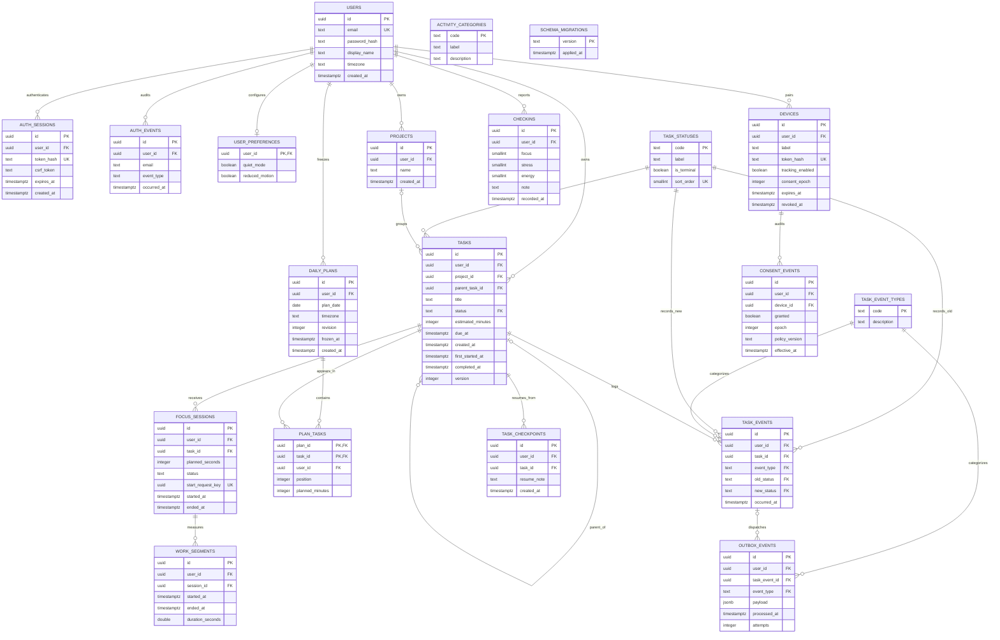

# Database design of the implemented core

The executable definition lives in `db/001_schema.sql` (16-table core) and `db/002_integrity_hardening.sql` (integrity hardening, applied automatically once at startup via `api/src/migrations.js` and tracked in `schema_migrations`). Together they define **20 relational tables** and **2 database views** in PostgreSQL 17, paired with **2 validated document collections** in MongoDB 8. Earlier 26-table diagrams describe a broader proposal.

## Why two databases?

PostgreSQL owns transactional facts: accounts, authentication audit logs, domain lookup tables, task relationships, immutable plan revisions, non-overlapping work segments, check-ins and consent. For example, a focus start must create both its session and its first segment; a partial write would make time reports unreliable. SQL transactions, triggers and constraints make these relationships explicit.

MongoDB owns optional timestamped browser observations (`activity_events`) and an asynchronous outbox mirror (`task_event_mirror`). Interval and tab-transition documents have different fields (`type`-discriminated polymorphism). MongoDB enforces a strict `oneOf` `$jsonSchema` validator (`additionalProperties: false`) while unique indexes enforce per-event identities and TTL indexes expire records after 30 days.

Both systems could be implemented using PostgreSQL alone. MongoDB is a deliberate educational design choice, not a claim that SQL cannot store events. Its cost is a second operational dependency and no built-in foreign key to SQL users or devices. The API must validate those references. Daily reports query both stores; they are not a globally atomic snapshot.

## Relational ER diagram

A crow's-foot line ending in `o{` means zero or more rows. Optional project, parent and session relationships are shown with `o|`. Every owned table carries a composite `(user_id, id)` reference chain to `users`; selected ownership edges are omitted below where redundant for readability. Both `db/001_schema.sql` and `db/002_integrity_hardening.sql` contain the authoritative constraints.



## Database views

- `v_task_continuity`: Joins `tasks` with lateral subqueries over `work_segments`/`focus_sessions` and `task_checkpoints`, plus child task counts, computing `initiation_latency_seconds`, `actual_seconds`, `segment_count`, `subtask_count`, `latest_note`, and `latest_note_at` inside PostgreSQL as a single source of truth.
- `v_consent_epoch_drift`: Compares `devices.consent_epoch` against `COALESCE(MAX(consent_events.epoch), 0)` and returns any divergent rows (expected empty; reported in `GET /api/reports/daily`).

## Integrity and normalization

- **1NF, 2NF, 3NF, and BCNF:** All 20 tables satisfy 1NF (atomic attributes, no repeating groups; multi-valued events/segments/checkpoints live in dedicated child tables), 2NF (`plan_tasks` depends on the full composite key `(plan_id, task_id)`), and 3NF/BCNF across domain entities because all non-trivial functional dependencies originate from candidate keys, including extracted lookup tables (`task_statuses`, `task_event_types`, `activity_categories`).
- **Controlled, intentional redundancies:**
  1. `user_id` is carried alongside `id` on child tables with composite `(user_id, id)` unique/foreign keys (`projects`, `tasks`, `daily_plans`, `focus_sessions`, `devices`) so PostgreSQL physically rejects cross-tenant references.
  2. `plan_tasks.planned_minutes` snapshots `tasks.estimated_minutes` at plan freeze time so historical intent stays intact if task estimates are edited later.
  3. `devices.consent_epoch` caches the latest epoch from the append-only `consent_events` ledger under `FOR UPDATE` + user advisory lock, continuously cross-checked by `v_consent_epoch_drift`.
- **Declarative boundary validation:** Regex email check, trimmed non-empty string lengths, bounded integers (`estimated_minutes BETWEEN 1 AND 480`, `focus/stress/energy BETWEEN 1 AND 5`), completion timestamp consistency (`(status='completed')=(completed_at IS NOT NULL)`), chronological timestamp bounds, and revocation consistency (`NOT(tracking_enabled AND revoked_at IS NOT NULL)`).
- **Temporal exclusion & generated duration:** `work_segments` uses `clock_timestamp()` as its default start and enforces `EXCLUDE USING gist (user_id WITH =, tstzrange(started_at, COALESCE(ended_at, 'infinity'::timestamptz), '[)') WITH &&)` so overlapping segments are impossible per user even under direct SQL writes. `duration_seconds` is a `GENERATED ALWAYS AS ... STORED` column.
- **SQL-enforced workflow rules & append-only auditability:** Triggers enforce single-level subtask nesting (`single_level_subtasks`), frozen-plan immutability (`frozen_plan`, `frozen_members`), and append-only audit logs (`task_events_append_only`, `consent_events_append_only`, `task_checkpoints_append_only`). Only the transactional account-erasure path (`api/src/erasure.js`) sets `SET LOCAL steady.allow_erasure = 'on'` to permit `DELETE` across `ERASURE_ORDER` while keeping `UPDATE` forbidden.
- **Concurrency & isolation:** API mutations use a per-user `pg_advisory_xact_lock`, partial unique indexes (`one_unfinished_session`, `one_open_segment`), and optimistic task `version` checks. SQL does not install PostgreSQL row-level security; API owner filters and composite keys provide application-level isolation.

## MongoDB collections

`activity_events` stores one observation per document validated by a strict polymorphic `$jsonSchema` (`api/src/mongo-schema.js`, `validationLevel: "moderate"`, `validationAction: "error"`, `additionalProperties: false`, and `oneOf` branching on `type`):
- **Common fields:** `userId` (UUID), `deviceId` (UUID), `eventId` (UUID), `type`, `at` (Date), `epoch`, `digest` (SHA-256 hex), `expiresAt` (Date).
- **`interval` variant:** requires `start`, `end`, `state` (`active`/`idle`), `domain` (hostname or `null`), and `category` (`study`/`necessary`/`leisure`/`uncategorized`).
- **`tab_switch` variant:** forbids interval-only fields via `not: { anyOf: [...] }`.
- **Indexes:** unique `(userId, deviceId, eventId)`, query index `(userId, at)`, and 30-day TTL index on `expiresAt` (`expireAfterSeconds: 0`). Because TTL removal is asynchronous, report/export queries also filter `expiresAt > now`.
- **Ingestion boundaries:** Uploads accept at most 200 events, maximum interval duration 61 seconds, and upload age of 7 days. Reusing an `eventId` with a different digest is rejected (`409`).

`task_event_mirror` is a derived outbox demonstration, not authoritative task history. Its unique `outboxId` makes retries safe; documents carry a `(userId)` index and expire after 30 days.

## Calculations & Verification

- Day window `W(d, z)` uses account timezone `z` via Luxon to preserve 23h/25h DST days.
- Interval union merges overlapping intervals (`O(n log n)`) and clips to each hourly/daily window so dual-device overlaps never double-count active time or exceed `3600s/hr`.
- Workflow metrics (`workflowMetrics` in `api/src/metrics.js`) compute initiation latency (decomposed vs. monolithic median), estimation calibration ratio, and checkpoint resumption lag.
- Relational schema invariants (migrations, triggers, `EXCLUDE USING gist`, generated columns, views, and complete account erasure) are directly tested against real PostgreSQL 17 WASM (`@electric-sql/pglite`) in `api/test/schema.test.js`; end-to-end PostgreSQL + MongoDB lifecycle tests live in `api/test/integration.mjs`.

## Example inspection queries

Run SQL with `docker compose exec postgres psql -U steady -d steady`:

```sql
-- Task continuity summary via DBMS view.
SELECT task_id, status, initiation_latency_seconds, actual_seconds, subtask_count
FROM v_task_continuity WHERE user_id = '<user-uuid>';

-- Verify zero drift between devices and append-only consent_events ledger.
SELECT * FROM v_consent_epoch_drift;

-- Pending cross-database outbox deliveries.
SELECT count(*) FROM outbox_events WHERE processed_at IS NULL;
```
